# Function-generated arithmetics

Reference implementation, numerical verification and a short paper (Polish and
English) for operations of the form

```
a ⊕ b = g⁻¹( g(a) + g(b) )
```

where `g` is a bijection. The scheme is the non-Newtonian calculus of Grossman
and Katz (1972), also studied as the relativity of arithmetic (Czachor, 2016).
This repository does three things: it states exactly what the scheme proves, it
classifies when the induced structure is a group, a monoid or a semigroup, and it
measures the numerical cost of the generators that have no elementary inverse.

**[Paper, Polish](paper/paper_pl.pdf)** · **[Paper, English](paper/paper_en.pdf)**

## Second paper: generator calculus

**[Rachunek generatorów (Polish)](paper/generator_calculus_pl.pdf)** extends the
scheme by two axes and tests the result on twenty physics problems.

| axis | what is chosen | what it yields |
|---|---|---|
| scale | generator `g` | `a ⊕ b = g⁻¹(g(a) + g(b))`, the subject of the first paper |
| unit | element `e` with `e² = +1`, `−1` or `0` | double, complex and dual numbers, Clifford multivectors, jets (derivatives as arithmetic), cyclic numbers |
| temperature | `h` in `a ⊕ₕ b = h ln(e^(a/h) + e^(b/h))` | decibels, free energy, the sum over paths; `h → 0` gives `(max, +)` and `(min, +)` |

Composition that does not commute is measured by the commutator (Thomas–Wigner
rotation).

Like the first paper, this one is a language, not a theory. It contains no new
theorem and predicts no new phenomenon. It measures one thing: twenty problems,
two from each of ten branches of physics, are written twice, in textbook
notation and in the notation of the three axes, and the symbols of both are
counted by one rule (`tex_len` in `src/problems.py`).

- The new notation is shorter in 17 problems and longer in 3. The median length
  ratio is 0.75.
- Every problem is computed along both routes and the two numbers agree: 17
  tests to 7·10⁻¹², three with a stated larger tolerance.
- Octonions, ordinal numbers and p-adic numbers stay outside the model.

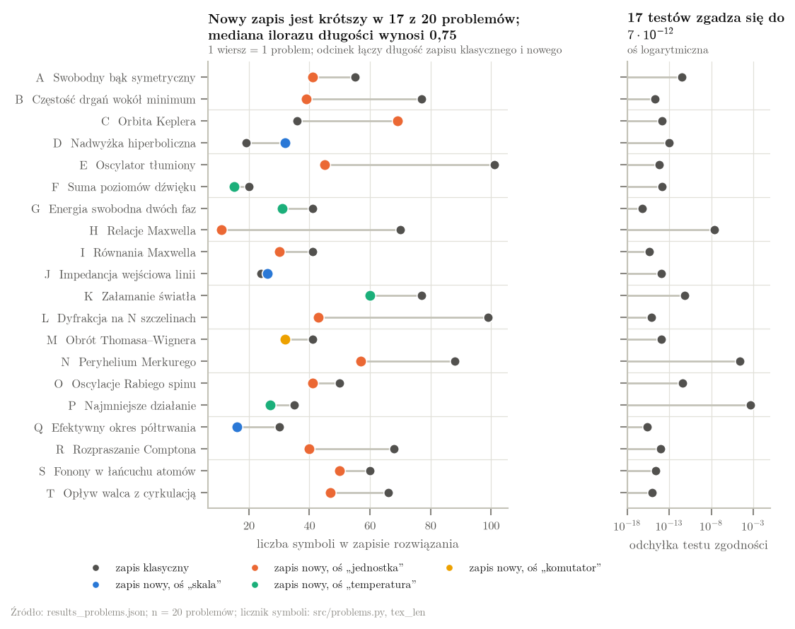

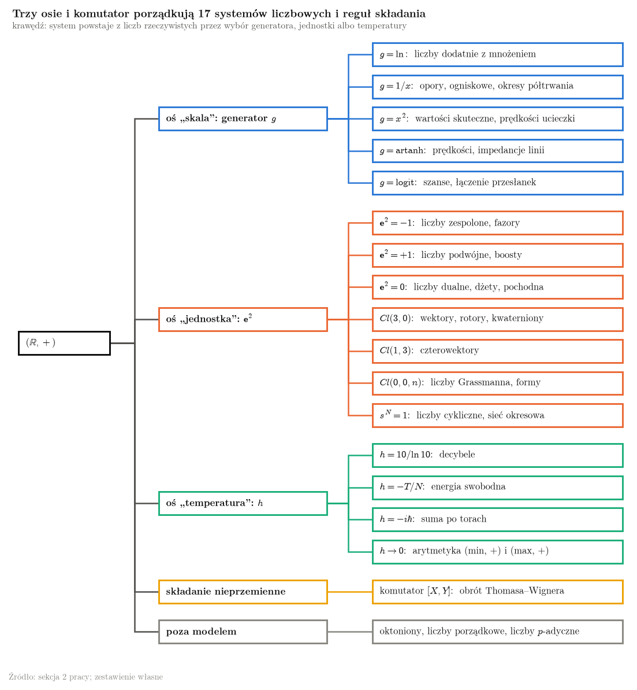

### Simulations

One per branch of physics, all produced by `scripts/figures.py`.

| | |
|---|---|
| 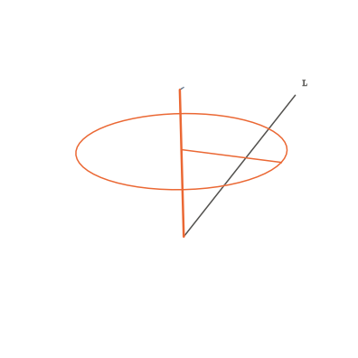<br>Free symmetric top: a rotor gives the attitude without integration | 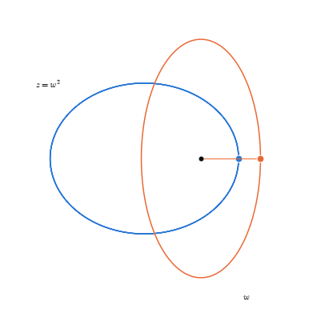<br>Kepler orbit: `w` moves harmonically, `z = w²` traces the ellipse |
| 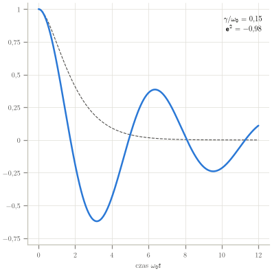<br>Damped oscillator: one formula through critical damping (`e² = 0`) | 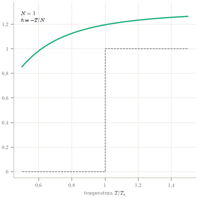<br>Two phases: as `h = −T/N → 0` the entropy becomes a step |
| 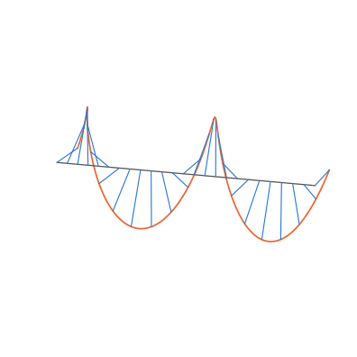<br>Circular wave: a vector turned by a rotor through `kz − ωt` | 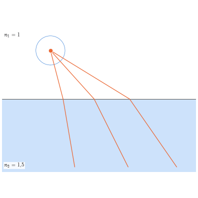<br>Refraction: a wavefront computed in `(min, +)` arithmetic |
| 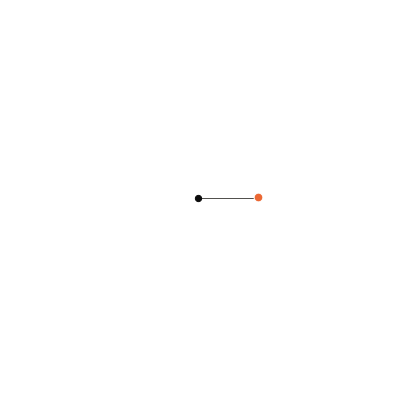<br>Perihelion advance of `2πλ` per orbit (here `λ = 0.04`) | 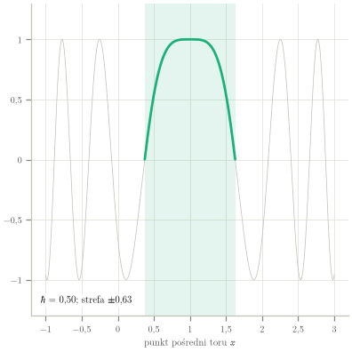<br>Sum over paths: phases agree only near the classical path |
| 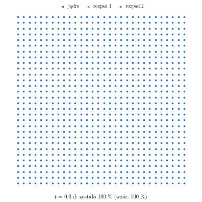<br>Two decay channels act as one with half-life `T₁ ⊕ T₂` | 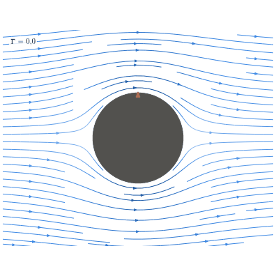<br>Flow past a cylinder: circulation moves the stagnation points |

## What this is, and what it is not

It is a language. For a chosen `g` it gives one notation for composition laws
that look different: parallel resistance, focal length, root-mean-square
voltage, sound level in decibels, relativistic velocity composition, pooling of
independent evidence.

It is not a new arithmetic. For every bijection `g` the operation is a transport
of `(ℝ, +)`, so associativity, commutativity, the neutral element, inverses and
distributivity hold automatically and are not discoveries. What can be new is
the choice of `g`, the domain of application and the implementation.

The repository also documents a **negative result**. The "synergy" operator

```
a ⊕ₛ b = g⁻¹( g(a) + g(b) + 2√(s·(g(a)+g(b))) )
```

is commutative but, for `s > 0`, neither associative nor unital. Measured
violations are in `results.json` and in Section 6 of the paper. It is usable as
a one-step nonlinear update in a control loop; it is not an arithmetic.

## Catalogue

| model | `g(x)` | `g⁻¹(y)` | domain | structure | `0_g` | `1_g` |
|---|---|---|---|---|---|---|
| harmonic | `1/x` | `1/y` | (0, ∞) | semigroup | — | — |
| power `p` | `xᵖ` | `y^(1/p)` | [0, ∞) | monoid | 0 | 1 |
| cubic | `x³` | `∛y` | ℝ | group | 0 | 1 |
| geometric | `ln x` | `eʸ` | (0, ∞) | group | 1 | e |
| logistic | `ln(x/(1−x))` | `1/(1+e⁻ʸ)` | (0, 1) | group | 0.5 | 0.7311 |
| softplus | `ln(eˣ−1)` | `ln(eʸ+1)` | (0, ∞) | group | 0.6931 | 1.3133 |
| Lambert | `x + ln x` | `W(eʸ)` | (0, ∞) | group | Ω = 0.5671 | 1 |
| relativistic | `artanh(x/c)` | `c·tanh y` | (−c, c) | group | 0 | 0.7616c |
| Kepler | `x + k·sin x` | numerical | ℝ | group | 0 | 0.5533 |
| Tsallis | `ln(1+εx)` | `(eʸ−1)/ε` | (−1/ε, ∞) | group | 0 | 3.4366 |

Two entries are weaker than usually assumed. The power arithmetic (`p = 2`:
RMS voltage, kinetic energy) is a **monoid** — it has no subtraction. The
harmonic arithmetic (parallel resistance, focal length) is a **semigroup** — it
has no zero.

## Reproduce

```bash
python scripts/verify.py      # all numbers in the paper; writes paper/data/*.dat
python -m pytest -q           # the same laws as unit tests
cd paper && pdflatex paper_pl.tex && pdflatex paper_pl.tex
cd paper && pdflatex paper_en.tex && pdflatex paper_en.tex

python -m src.problems        # second paper: 20 problems, both routes; writes results_problems.json
python scripts/figures.py     # second paper: 12 figures and 10 animations
cd paper && pdflatex generator_calculus_pl.tex && pdflatex generator_calculus_pl.tex
```

Only `numpy` is required for the checks. The figures of the second paper need
`matplotlib` and `seaborn`. The PDFs need a TeX Live installation with
`pgfplots`, `babel-polish`, `csquotes`, `icomma` and `placeins`.

## Layout

```
paper/paper_pl.tex       paper/paper_pl.pdf      source and build, Polish
paper/paper_en.tex       paper/paper_en.pdf      source and build, English
paper/fga.sty                                    shared preamble
paper/data/*.dat                                 data for the three figures
src/fga.py                                       reference implementation
scripts/verify.py                                verification and data generation
results.json                                     machine-readable results
tests/test_axioms.py                             pytest wrapper

paper/generator_calculus_pl.tex  .pdf            second paper, Polish
paper/data/problems_table.tex                    generated formulas and numbers of the second paper
paper/figures/                                   figures (pdf, png) and animations (gif)
src/gcalc.py                                     units, jets and the thermal sum
src/problems.py                                  twenty problems: two notations, checks, symbol count
scripts/figures.py                               figures and animations
results_problems.json                            machine-readable results of the second paper
tests/test_problems.py                           pytest wrapper
```

## Selected results

All values are produced by `scripts/verify.py`; nothing in the tables is typed
by hand.

- `6 ⊕ 3 = 2.000000` (parallel resistance), `50 ⊕ 200 = 40.000000` (focal length)
- `230 ⊕ 45 = 234.360833 V` (RMS), `800 ⊕ 1000 = 1089.617257 K` (Stefan–Boltzmann)
- `80 ⊕ 80 = 83.010300 dB` (not 160 dB)
- `0.5c ⊕ 0.5c = 0.8c`, `0.9c ⊕ 0.9c = 0.994475c` (never exceeds `c`)
- `0.8 ⊕ 0.7 = 0.903226` (pooling two independent pieces of evidence)
- Lambert: `0_g = Ω = 0.5671432904097838`; the additive regime is reached to 1 %
  at `x > 25.1`
- Lambert inverse: `W(eʸ)` overflows for `y > 709.78`; solving `x + ln x = y`
  in the log domain works up to `y = 10⁶` and beyond
- Kepler: `1_g = 0.553316`, not `1` (`g(1) = 1.715250`)
- Synergy operator, `s = 0.5`: associativity violated by `4.8 · 10⁻²`,
  neutral element violated by `1.14`

## Citing

`CITATION.cff` is included. The two papers are the canonical reference:

```
Szulia, M. (2026). Function-generated arithmetics: catalogue, structural
classification and numerical limits of the scheme a ⊕ b = g⁻¹(g(a)+g(b)).
```

## License

MIT. See `LICENSE`.
